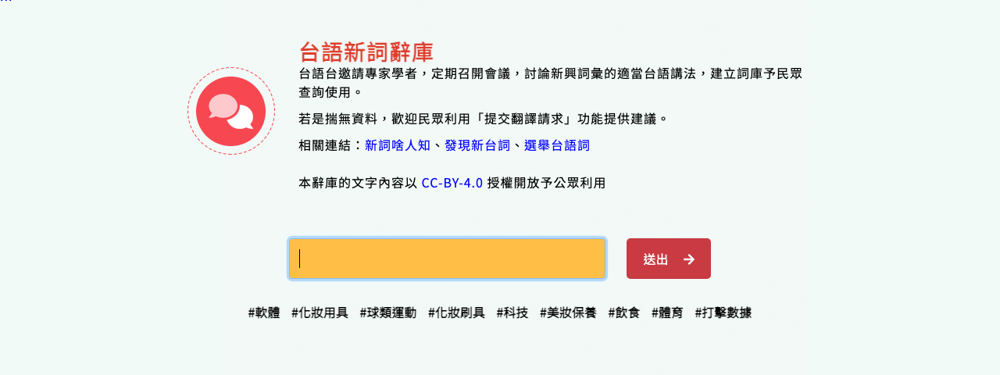

# KongsiTaigiTaiTaigiSinSuSukhooDataMirror

Data mirror for the 公視台語台 台語新詞辭庫 (Kong-sī Tâi-gí-tâi Tâi-gí Sin-sû Sû-khò͘, the Taigi neologism lexicon of PTS Taigi). This site provides direct access to the extracted entry data and pronunciation audio. The files are hosted on GitHub Pages for easy access.

## Chu-liāu Pán-koân

版權聲明

- 本辭庫的文字內容以 [CC-BY-4.0](https://creativecommons.org/licenses/by/4.0/deed.zh-hant) 授權開放予公眾利用（see <https://www.taigitv.org.tw/taigi-words>）
- The CC-BY-4.0 statement on the source site covers the text content. The audio files are mirrored as-is from the source site for the convenience of researchers and the ChhoeTaigi project; their licence is not stated separately by the source.

## Latest Version

- **Version ID:** `20261010-2358`
- **Last Updated:** 2026-10-10
- **Entries:** 2157 (2490 readings / audio files)

You can check [**manifest.json**](./public/manifest.json) for the latest version information programmatically.

## Accessing Files

The files are organized by version. The latest files are in `public/20261010-2358/`.

### 1. Text Data (`bunji/`)

- [**KongsiTaigiTaiTaigiSinSuSukhooData.csv**](./public/20261010-2358/bunji/KongsiTaigiTaiTaigiSinSuSukhooData.csv) (one row per entry, UTF-8)
- [**KongsiTaigiTaiTaigiSinSuSukhooData.json**](./public/20261010-2358/bunji/KongsiTaigiTaiTaigiSinSuSukhooData.json) (nested, one object per entry)

#### Data Fields

| Field | Description |
|-------|-------------|
| `id` | Entry id on the source site (`https://www.taigitv.org.tw/taigi-words/{id}`) |
| `漢字` | Headword as written on the site (詞目): Hanji, Taigi Roman Orthography, or mixed |
| `KPL` | Readings in KPL (Kàu-io̍k Pō͘ Lô-má-jī / 臺羅), as published by the source. JSON: inside the `音讀` list |
| `POJ` | The same readings in POJ (Pe̍h-ōe-jī), derived from `KPL` (see below). JSON: inside the `音讀` list |
| `音讀` | JSON only: list of readings, each `{KPL, POJ, 音檔, 音檔來源網址, 音檔原始網址}` |
| `對應華語` | Corresponding Mandarin term |
| `標籤` | Tags (topic categories). JSON: list of names. CSV: joined by `/` |
| `例句` | JSON only: example sentences from the detail page, each `{漢羅, KPL, POJ, 華語}` (POJ derived from KPL). Most entries have none or one |
| `例句漢羅`, `例句KPL`, `例句POJ`, `例句華語` | CSV: the example sentence fields, several sentences joined by a newline |
| `相關影音` | Related videos from the detail page, as YouTube watch URLs (`https://www.youtube.com/watch?v=ID`, with `&t=Ns` when the embed had a start offset). JSON: list. CSV: joined by `;` |
| `音檔` | Local audio filename(s) under `imtong/`, one per reading, in the same order as `KPL`. Empty when the source link is dead (listed as `imtong_missing` in `manifest.json`) |
| `音檔來源網址` | Full URL(s) of the mirrored audio on GitHub Pages (`https://chhoetaigi.github.io/KongsiTaigiTaiTaigiSinSuSukhooDataMirror/public/{version}/imtong/{音檔}`). Empty when `音檔` is empty |
| `音檔原始網址` | Original audio URL(s) on the source site (storage.googleapis.com) |
| `網址` | Entry page URL |

Entries are sorted by `id` ascending. In the CSV, an entry with several readings joins them with `/` in `KPL`, `POJ` and `音檔` (e.g. `bû-jîn-ki/bô-lâng-ki/bû-lîn-ki`); `標籤` also uses `/`; `相關影音`, `音檔來源網址` and `音檔原始網址` use `;` because URLs contain slashes; the `例句*` columns use a newline between sentences. The n-th value of each column belongs together. A few source readings contain `/` themselves as an inline variant (`kué/ké-á`); the JSON keeps readings as a list and is unambiguous.

#### KPL → POJ

The source publishes KPL only. `POJ` and `例句POJ` are generated by `script/lomaji.py`, a Python port of the KPL → POJ route of [KonvertToPOJ](https://github.com/PehoejiKesi/KonvertToPOJ) (GPL-3.0): the tone is read off the diacritic, the letters are mapped (`ts/tsh → ch/chh`, `ua/ue → oa/oe`, `ik/ing → ek/eng`, `oo → o͘`, `nn → ⁿ`, tone 9 `a̋ → ă`) and the tone mark is re-placed by the POJ rules. Tokens that are not shaped like a Taigi syllable (`ECMO`, `BB`, `TRX`, digits) are kept as they are.

### 2. Pronunciation Audio (`imtong/`)

- **Base URL:** `https://chhoetaigi.github.io/KongsiTaigiTaiTaigiSinSuSukhooDataMirror/public/20261010-2358/imtong/`
- **Filename pattern:** `{id}.wav` for the first reading, `{id}-2.wav`, `{id}-3.wav`, ... for further readings of the same entry. One upstream file is an `.mp3`, so take the filename from the row's `音檔` field rather than composing it.
- **Example:** `https://chhoetaigi.github.io/KongsiTaigiTaiTaigiSinSuSukhooDataMirror/public/20261010-2358/imtong/2388.wav`
- **Missing files:** a few upstream audio links return 404 (25 of 2490 readings in this version). Those readings have an empty `音檔` and `音檔來源網址`, keep their `音檔原始網址`, and are listed in `manifest.json` under `imtong_missing`.

## Chu-liāu bāng-chí

辭庫資料來源（網頁，無提供整批下載；本 mirror 爬 180 頁列表佮每一條詞目的頁面）

1. [台語新詞辭庫（公視台語台）](https://www.taigitv.org.tw/taigi-words)
2. [台語新詞辭庫（獨立網站）](https://taigiwords.taigitv.org.tw/)

## Source

Original data source: 公視台語台 台語新詞辭庫 <https://www.taigitv.org.tw/taigi-words>
